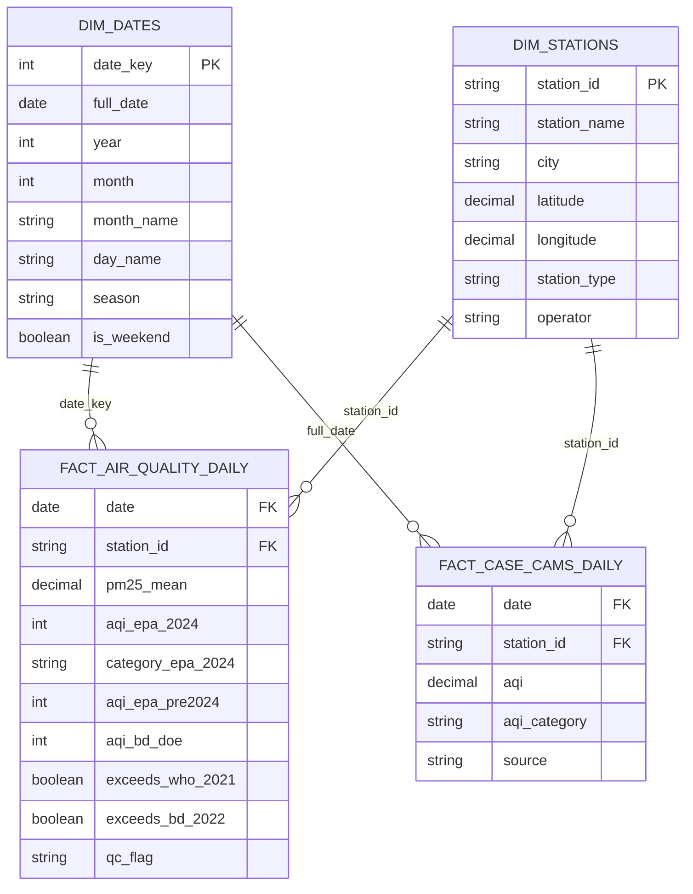

# Dhaka Air Quality Analytics - Power BI Dashboard Specification
**File:** `powerbi/POWER_BI_SPEC.md`  
**Target:** Power BI Desktop / Power BI Service  

---

## 1. Data Model Architecture (Star Schema)

The data model follows an industry-standard dimensional Star Schema:

### Table Relationships
1. `dim_dates[full_date]` $\rightarrow$ `fact_air_quality_daily[date]` (1-to-Many, Single Direction)
2. `dim_stations[station_id]` $\rightarrow$ `fact_air_quality_daily[station_id]` (1-to-Many, Single Direction)
3. `dim_stations[station_id]` $\rightarrow$ `fact_case_cams_daily[station_id]` (1-to-Many, Single Direction)

---

## 2. Dashboard Page Structure (5 Pages)

### Page 1: Executive Overview
- **Header:** Dhaka Air Quality Monitor | Real-Time & Historical Analytics
- **Top KPI Cards (Row 1):**
  1. `[Average PM25]`: $87.5\,\mu\text{g/m}^3$
  2. `[Average AQI EPA 2024]`: $162$ (Unhealthy)
  3. `[Pct Days Above WHO Guideline]`: $97.6\%$
  4. `[Pct Days Above Bangladesh Standard]`: $47.8\%$
  5. `[Valid Compliant Days]`: $1,781$ days
- **Visual 1 (Line & Area Chart):** 30-Day Rolling PM2.5 Concentration vs WHO ($15\,\mu\text{g/m}^3$) and Bangladesh ($65\,\mu\text{g/m}^3$) benchmarks.
- **Visual 2 (Donut Chart):** Days by AQI Category under Revised US EPA 2024 Standard.
- **Slicers (Left Panel):** Date Range, Climatological Season, Weekend vs Weekday.

### Page 2: Trends & Seasonality
- **Visual 1 (Heatmap Matrix):** Year $\times$ Month Mean PM2.5 Concentration Matrix.
- **Visual 2 (Clustered Column Chart):** Seasonal PM2.5 Comparison (Winter vs Pre-Monsoon vs Monsoon vs Post-Monsoon).
- **Visual 3 (Line Chart):** Diurnal 24-Hour Concentration Curve (00:00 to 23:00 BST) highlighting the 23:00 nocturnal peak ($103.9\,\mu\text{g/m}^3$).
- **Visual 4 (Bar Chart):** Day of Week Profile (Friday-Saturday Bangladesh weekend vs weekdays).

### Page 3: Station & Spatial Comparison
- **Visual 1 (Map / ArcGIS Visual):** Geospatial Bubble Map of monitoring stations across Dhaka and Bangladesh colored by Mean AQI.
- **Visual 2 (Horizontal Bar Chart):** Station Ranking across Bangladesh DoE CAMS Network (Dhaka Darus Salam CAMS-3: 179.6, Farmgate CAMS-2: 169.2, Manik Mia CAMS-1: 158.2, Narayanganj: 179.5, Gazipur: 165.2, Sylhet: 105.3).
- **Visual 3 (Table / Matrix):** Station Detailed Scorecard (Total Readings, Mean AQI, Median AQI, Max Peak AQI).

### Page 4: Pollutant & Standards Impact
- **Visual 1 (Grouped Bar Chart):** Distribution Shift in Days per Category: US EPA Revised 2024 vs Classic Pre-2024 standards (+78% Hazardous days under 2024 rule).
- **Visual 2 (Scatter Plot):** Anomaly Detection Scatter plot showing 25 extreme winter pollution spikes exceeding $+2.5\sigma$.

### Page 5: Data Notes & Limitations
- **Data Provenance:** U.S. Department of State / AirNow DOS BAM-1020 FEM monitor; Bangladesh Department of Environment CASE project CAMS bulletins.
- **Timezone Notice:** Standardized strictly to `Asia/Dhaka` (UTC+6).
- **Completeness Standard:** $\ge 75\%$ valid hours per 24-hour day ($18/24$ hours).
- **Statutory Citations:** WHO 2021 Global Air Quality Guidelines ($15\,\mu\text{g/m}^3$ daily, $5\,\mu\text{g/m}^3$ annual); Bangladesh S.R.O. 255-Law/2022 ($65\,\mu\text{g/m}^3$ daily, $15\,\mu\text{g/m}^3$ annual).
- **Analytical Limitations:** Single FEM monitor in Baridhara reflects urban residential/diplomatic microenvironment; lack of direct emission inventories means emission sources are classified strictly as `[Hypothesis]`.

---

## 3. Official Brand & Color Palette

| Palette Role | Hex Code | Purpose |
| :--- | :--- | :--- |
| **Primary Navy** | `#1A2530` | Canvas headers, navigation background |
| **Accent Blue** | `#2980B9` | Primary metric lines and rolling averages |
| **WHO Guideline Red** | `#C0392B` | WHO exceedance benchmark threshold ($15\,\mu\text{g/m}^3$) |
| **BD Standard Orange**| `#E67E22` | Bangladesh statutory standard ($65\,\mu\text{g/m}^3$) |
| **AQI Good** | `#00E400` | AQI $0 - 50$ |
| **AQI Moderate** | `#FFFF00` | AQI $51 - 100$ |
| **AQI USG / Caution**| `#FF7E00` | AQI $101 - 150$ |
| **AQI Unhealthy** | `#FF0000` | AQI $151 - 200$ |
| **AQI Very Unhealthy**| `#8F3F97` | AQI $201 - 300$ |
| **AQI Hazardous** | `#7E0023` | AQI $301+$ |
